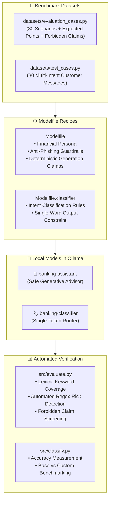

<div align="center">

# ⚡ PromptTune: The Complete LLM Fine-Tuning & Adaptation Suite

### *A Production Guide & Master Repository for 20 Modern Fine-Tuning, Alignment, and Prompt-Engineered Adaptation Techniques — from Zero-Weight Ollama Modelfiles to LoRA, DPO, and GRPO.*

<br/>

[](https://python.org)
[](https://ollama.com)
[](https://pytorch.org)
[](https://huggingface.co)
[](LICENSE)

<p align="center">
  <b>20 Fine-Tuning Architectures</b> • <b>Zero-Weight Modelfile Tuning</b> • <b>Deterministic Guardrails</b> • <b>Empirical Benchmarks</b>
</p>

[Prompt Tuning Methodology](#-the-methodology-fine-tuning-via-prompt-engineering) • [Master Taxonomy of 20 Techniques](#-master-taxonomy-all-20-fine-tuning-techniques) • [Case Study & Benchmarks](#-case-study-banking--financial-services) • [Parameters Reference](#-hyperparameters--runtime-parameters) • [Quick Start](#-quick-start)

---

</div>

<br/>

## 📖 The Methodology: Fine-Tuning via Prompt Engineering

### What is "Zero-Weight" Fine-Tuning?

When developers discuss "fine-tuning", they typically mean **Weight-Based Fine-Tuning** (LoRA, QLoRA, or Full Parameter Fine-Tuning). While essential for deep linguistic domain shifts, training neural network weights requires dedicated GPU clusters, large dataset formatting, long training iterations, and introduces the risk of **catastrophic forgetting** (where a model loses foundational reasoning skills).

**Prompt-Engineered Fine-Tuning (Modelfile-Based Model Specialization)** adapts model behavior at the container manifest level:
1. **Permanent Persona Anchoring:** The base model is wrapped with a hardened system directive embedded directly into the model manifest.
2. **Deterministic Sampling Constraints:** Temperature, nucleus sampling ($top\_p$), vocabulary pooling ($top\_k$), and repetition penalties are tuned and locked.
3. **Strict Negative Boundaries:** Guardrails specify what the model *must never* say or do.
4. **Output Format Enforcement:** Context bounds and stop sequences truncate conversational drift and force structured or single-word outputs.
5. **Standalone Model Packaging:** The resulting configuration is compiled into a standalone, versioned model artifact (`ollama create my-model -f Modelfile`) that can be pushed, pulled, and executed like any traditional fine-tuned checkpoint.

<br/>

### ⚖️ Comparison: Traditional Weight Tuning vs. Prompt-Engineered Specialization

<div align="center">

| Dimension | 🏋️ Traditional Weight Fine-Tuning (LoRA / QLoRA / FFT) | ⚡ Prompt-Engineered Tuning (Modelfile) |
| :--- | :--- | :--- |
| **Mechanism** | Updates adapter weight matrices ($\Delta W$) or full tensors | Hardens system directives, stops, & decoding parameters |
| **Hardware Required** | 16 GB - 80 GB+ VRAM (A100 / H100) | **Runs on any Consumer GPU or CPU (4 GB VRAM)** |
| **Build Time** | Hours to days of gradient descent | **Instant (< 5 seconds via `ollama create`)** |
| **Compute Cost** | Cloud compute charges ($$$) | **$0.00 — 100% Free & Local** |
| **Risk of Forgetting** | High (degrades unrelated reasoning tasks) | **Zero (base model reasoning stays intact)** |
| **Safety & Guardrails** | Soft (can be jailbroken or bypassed) | **Strict (enforced via stop tokens & parameter clamps)** |
| **Portability** | Requires checkpoint weights + adapter merges | **Single plain-text `Modelfile` recipe** |

</div>

<br/>

---

## 📚 Master Taxonomy: All 20 Fine-Tuning Techniques

This repository provides production-ready, modular Python implementations for **all 20 major fine-tuning, parameter-efficient adaptation, continual pretraining, and preference alignment techniques** located in [`fine_tuning_techniques/`](file:///c:/Users/Rishav/Disk/Codes/LLM%20Projects/Fine_Tuning/fine_tuning_techniques).

```mermaid
flowchart TD
    FT["🎯 LLM Adaptation & Alignment Spectrum"]

    FT --> W["🏋️ 1. Weight-Level Adaptation"]
    W --> W1["01. Full Fine-Tuning (FFT)"]
    W --> W2["02. PEFT Architecture Overview"]
    W --> W3["03. LoRA (Low-Rank Adaptation)"]
    W --> W4["04. QLoRA (4-bit Quantized LoRA)"]
    W --> W5["13. Bottleneck Adapter Tuning"]

    FT --> S["📝 2. Supervised & Instruction Tuning"]
    S --> S1["05. Supervised Fine-Tuning (SFT)"]
    S --> S2["06. Instruction Tuning (Masked Loss)"]

    FT --> C["🌐 3. Pretraining & Continual Learning"]
    C --> C1["07. Continued Pretraining (CPT)"]
    C --> C2["08. Domain-Adaptive Pretraining (DAPT)"]
    C --> C3["09. Task-Adaptive Pretraining (TAPT)"]

    FT --> P["🎛️ 4. Soft Prompts & Prefix Tuning"]
    P --> P1["14. Prefix Tuning (Virtual KV Vectors)"]
    P --> P2["15. Prompt Tuning (Soft Input Embeddings)"]
    P --> P3["16. P-Tuning v1/v2 (LSTM Reparameterization)"]

    FT --> A["🤝 5. Preference Alignment & RL"]
    A --> A1["10. RLHF (3-Stage Reward Model + PPO)"]
    A --> A2["11. Direct Preference Optimization (DPO)"]
    A --> A3["17. Odds Ratio Preference Optimization (ORPO)"]
    A --> A4["18. Kahneman-Tversky Optimization (KTO)"]
    A --> A5["19. Proximal Policy Optimization (PPO Engine)"]
    A --> A6["20. Group Relative Policy Optimization (GRPO)"]

    FT --> D["🧊 6. Compression & Distillation"]
    D --> D1["12. Knowledge Distillation (Teacher-Student Logits)"]
```



<br/>

### Detailed Breakdown of All 20 Techniques

#### 1. Full Fine-Tuning (FFT)
* **Mathematical Concept:** Updates all model parameters $W \in \mathbb{R}^{d \times k}$ via backpropagation: $W_{new} = W_{old} - \eta \nabla \mathcal{L}$.
* **How It Must Be Done:** Requires storing parameters, gradients, and optimizer states (AdamW requires 16 bytes per parameter in mixed precision). A 7B parameter model requires $\approx 112\text{ GB}$ VRAM. Employs DeepSpeed ZeRO-3 or FSDP across multi-GPU nodes.
* **Code Implementation:** [`fine_tuning_techniques/01_full_fine_tuning.py`](file:///c:/Users/Rishav/Disk/Codes/LLM%20Projects/Fine_Tuning/fine_tuning_techniques/01_full_fine_tuning.py) — Configures distributed CausalLM training with gradient checkpointing and full weight updates.

#### 2. Parameter-Efficient Fine-Tuning (PEFT Overview)
* **Mathematical Concept:** Freezes base weights $W_0$ and optimizes a tiny parameter subspace $\theta$: $h = W_0 x + \Delta W(\theta)x$, where $|\theta| \ll |W_0|$.
* **How It Must Be Done:** Targets $0.05\% - 2\%$ trainable parameter ratios, cutting optimizer memory by up to 99%.
* **Code Implementation:** [`fine_tuning_techniques/02_peft_overview.py`](file:///c:/Users/Rishav/Disk/Codes/LLM%20Projects/Fine_Tuning/fine_tuning_techniques/02_peft_overview.py) — Provides an automated taxonomy comparison and parameter footprint inspector across PEFT methods.

#### 3. LoRA (Low-Rank Adaptation)
* **Mathematical Concept:** Decomposes weight updates into low-rank matrices: $\Delta W = \frac{\alpha}{r}(B \times A)$, where $A \in \mathbb{R}^{r \times k} \sim \mathcal{N}(0, \sigma^2)$ and $B \in \mathbb{R}^{d \times r} = 0$.
* **How It Must Be Done:** Select rank $r \in [8, 64]$ and scaling $\alpha = 2r$. Injects adapters into attention projections (`q_proj`, `v_proj`) and MLP layers. Zero inference latency once merged ($W_{merged} = W_0 + \frac{\alpha}{r}BA$).
* **Code Implementation:** [`fine_tuning_techniques/03_lora.py`](file:///c:/Users/Rishav/Disk/Codes/LLM%20Projects/Fine_Tuning/fine_tuning_techniques/03_lora.py) — Implements adapter initialization, training loop, and weight-folding export.

#### 4. QLoRA (Quantized Low-Rank Adaptation)
* **Mathematical Concept:** Freezes base model weights in **4-bit NormalFloat (NF4)** with Double Quantization (DQ), calculating gradients through frozen 4-bit weights into 16-bit LoRA adapters.
* **How It Must Be Done:** Requires `bitsandbytes`, `prepare_model_for_kbit_training`, and Paged Optimizers (`paged_adamw_8bit`) to eliminate memory spikes during gradient checkpointing. Allows fine-tuning 7B models on 6 GB VRAM and 70B models on 48 GB VRAM.
* **Code Implementation:** [`fine_tuning_techniques/04_qlora.py`](file:///c:/Users/Rishav/Disk/Codes/LLM%20Projects/Fine_Tuning/fine_tuning_techniques/04_qlora.py) — Sets up 4-bit NF4 quantization configs and low-memory training harnesses.

#### 5. Supervised Fine-Tuning (SFT)
* **Mathematical Concept:** Causal language modeling on curated dialogue demonstrations: $\mathcal{L}_{SFT} = -\sum_{t=1}^T \log P(y_t \mid x, y_{<t}; \theta)$.
* **How It Must Be Done:** Formats multi-turn user/assistant conversations with standardized chat templates (`<|im_start|>user...<|im_end|>`).
* **Code Implementation:** [`fine_tuning_techniques/05_sft.py`](file:///c:/Users/Rishav/Disk/Codes/LLM%20Projects/Fine_Tuning/fine_tuning_techniques/05_sft.py) — Implements HuggingFace TRL `SFTTrainer` with token packing.

#### 6. Instruction Fine-Tuning
* **Mathematical Concept:** Adapts models to follow natural language task directives with **Response-Only Loss Masking**.
* **How It Must Be Done:** Tokens belonging to the prompt instruction are masked with label `-100`. Gradients are calculated exclusively on completion tokens, ensuring model capacity is focused on generation rather than memorizing prompt syntax.
* **Code Implementation:** [`fine_tuning_techniques/06_instruction_tuning.py`](file:///c:/Users/Rishav/Disk/Codes/LLM%20Projects/Fine_Tuning/fine_tuning_techniques/06_instruction_tuning.py) — Utilizes TRL's `DataCollatorForCompletionOnlyLM` with Alpaca/ChatML templates.

#### 7. Continued Pretraining (CPT)
* **Mathematical Concept:** Continues unsupervised next-token prediction on large raw document streams: $\mathcal{L}_{CPT} = -\sum_{i=1}^N \log P(w_i \mid w_{<i})$.
* **How It Must Be Done:** Documents are concatenated and chopped into uniform block sizes (e.g., 2048 or 4096 tokens) with chunk packing. Uses a conservative learning rate ($1\times 10^{-5}$ to $3\times 10^{-5}$) with cosine decay to prevent catastrophic forgetting.
* **Code Implementation:** [`fine_tuning_techniques/07_cpt.py`](file:///c:/Users/Rishav/Disk/Codes/LLM%20Projects/Fine_Tuning/fine_tuning_techniques/07_cpt.py) — Demonstrates token concatenation and packed chunk modeling.

#### 8. Domain-Adaptive Pretraining (DAPT)
* **Mathematical Concept:** Continued pre-training on broad domain-specific text (e.g., millions of legal briefs, medical papers, or financial filings) to internalize domain vocabulary and sentence structure.
* **How It Must Be Done:** Monitored using **Domain Perplexity** ($PPL = \exp(\mathcal{L}_{CE})$). A steep drop in perplexity on a held-out domain validation set verifies vocabulary adaptation before supervised fine-tuning.
* **Code Implementation:** [`fine_tuning_techniques/08_dapt.py`](file:///c:/Users/Rishav/Disk/Codes/LLM%20Projects/Fine_Tuning/fine_tuning_techniques/08_dapt.py) — Implements domain validation splits and perplexity tracking.

#### 9. Task-Adaptive Pretraining (TAPT)
* **Mathematical Concept:** Pre-training on the exact, hyper-targeted distribution of unlabeled task queries (e.g., raw customer support tickets) immediately prior to downstream task tuning.
* **How It Must Be Done:** Demonstrates that even small amounts of task data ($1\text{ MB} - 50\text{ MB}$) can yield significant downstream benchmark gains when applied right before task fine-tuning.
* **Code Implementation:** [`fine_tuning_techniques/09_tapt.py`](file:///c:/Users/Rishav/Disk/Codes/LLM%20Projects/Fine_Tuning/fine_tuning_techniques/09_tapt.py) — Implements task-adaptive causal pretraining pipelines.

#### 10. Reinforcement Learning from Human Feedback (RLHF - PPO)
* **Mathematical Concept:** 3-stage alignment: 1) SFT, 2) Train Bradley-Terry reward model $r_\psi(x, y)$, 3) Optimize policy $\pi_\theta$ using PPO with a KL penalty: $\max_\theta \mathbb{E}[r_\psi(x, y) - \beta \mathbb{D}_{KL}(\pi_\theta \parallel \pi_{ref})]$.
* **How It Must Be Done:** Coordinates 4 concurrent networks: Actor (Policy), Critic (Value Head), Reference Model (Frozen SFT), and Reward Model.
* **Code Implementation:** [`fine_tuning_techniques/10_rlhf_ppo.py`](file:///c:/Users/Rishav/Disk/Codes/LLM%20Projects/Fine_Tuning/fine_tuning_techniques/10_rlhf_ppo.py) — Constructs sequence classification reward models and TRL `PPOTrainer`.

#### 11. Direct Preference Optimization (DPO)
* **Mathematical Concept:** Derives an exact analytical substitution for the optimal reward function $r^*(x, y) = \beta \log \frac{\pi_\theta(y \mid x)}{\pi_{ref}(y \mid x)}$, solving RLHF without a reward model:
  $$\mathcal{L}_{DPO} = -\mathbb{E}_{(x, y_w, y_l)} \left[ \log \sigma \left( \beta \log \frac{\pi_\theta(y_w \mid x)}{\pi_{ref}(y_w \mid x)} - \beta \log \frac{\pi_\theta(y_l \mid x)}{\pi_{ref}(y_l \mid x)} \right) \right]$$
* **How It Must Be Done:** Requires pairwise preference datasets containing `{prompt, chosen, rejected}` tuples. Eliminates RL training instability and reduces VRAM requirements by half.
* **Code Implementation:** [`fine_tuning_techniques/11_dpo.py`](file:///c:/Users/Rishav/Disk/Codes/LLM%20Projects/Fine_Tuning/fine_tuning_techniques/11_dpo.py) — Implements TRL `DPOTrainer` with LoRA integration.

#### 12. Knowledge Distillation (KD)
* **Mathematical Concept:** Compresses an overparameterized Teacher ($T$) into a compact Student ($S$) using a blended loss:
  $$\mathcal{L}_{KD} = (1 - \alpha)\mathcal{L}_{CE}(y, \sigma(z_S)) + \alpha \tau^2 \mathbb{D}_{KL}\left(\sigma(z_T / \tau) \parallel \sigma(z_S / \tau)\right)$$
* **How It Must Be Done:** Temperature $\tau > 1$ softens logit distributions to expose "dark knowledge" (relative probabilities across non-target tokens).
* **Code Implementation:** [`fine_tuning_techniques/12_knowledge_distillation.py`](file:///c:/Users/Rishav/Disk/Codes/LLM%20Projects/Fine_Tuning/fine_tuning_techniques/12_knowledge_distillation.py) — Features a custom `DistillationTrainer` subclass with forward-pass logit softened KL divergence.

#### 13. Adapter-Based Fine-Tuning (Bottleneck Adapters)
* **Mathematical Concept:** Series bottleneck layers (Houlsby et al., 2019; Pfeiffer et al., 2020) placed after attention and FFN blocks: $\text{Adapter}(h) = \text{LayerNorm}(h + W_{up} \cdot \text{GeLU}(W_{down} \cdot h))$.
* **How It Must Be Done:** Down-projects hidden dimension $d \to m$ (where $m \ll d$) and up-projects back to $d$, keeping the base model completely frozen.
* **Code Implementation:** [`fine_tuning_techniques/13_adapter_tuning.py`](file:///c:/Users/Rishav/Disk/Codes/LLM%20Projects/Fine_Tuning/fine_tuning_techniques/13_adapter_tuning.py) — Custom PyTorch implementation of the `BottleneckAdapter` module and layer wrapping harness.

#### 14. Prefix Tuning
* **Mathematical Concept:** Injects learnable virtual Key and Value tensors ($P_K^{(l)}, P_V^{(l)}$) into the Multi-Head Attention of **every** transformer layer (Li & Liang, 2021).
* **How It Must Be Done:** Attends across combined representations: $\text{Attention}(Q, [P_K; K], [P_V; V])$. Parameterized initially via a 2-layer MLP for training stability.
* **Code Implementation:** [`fine_tuning_techniques/14_prefix_tuning.py`](file:///c:/Users/Rishav/Disk/Codes/LLM%20Projects/Fine_Tuning/fine_tuning_techniques/14_prefix_tuning.py) — Implements PEFT `PrefixTuningConfig` for causal language models.

#### 15. Prompt Tuning (Soft Prompts)
* **Mathematical Concept:** Injects $p$ continuous virtual token embeddings $P \in \mathbb{R}^{p \times d}$ **exclusively** into the input word embedding space (Lester et al., 2021).
* **How It Must Be Done:** Freezes 100% of the transformer layers. As models scale past 10B parameters, Prompt Tuning matches Full Fine-Tuning while training fewer than $0.01\%$ of parameters.
* **Code Implementation:** [`fine_tuning_techniques/15_prompt_tuning.py`](file:///c:/Users/Rishav/Disk/Codes/LLM%20Projects/Fine_Tuning/fine_tuning_techniques/15_prompt_tuning.py) — Configures text-initialized soft prompt embeddings with `PromptTuningConfig`.

#### 16. P-Tuning (v1 / v2)
* **Mathematical Concept:** Models sequential dependencies between virtual prompt tokens using an auxiliary prompt encoder (Bidirectional LSTM + MLP) rather than treating them as independent soft vectors (Liu et al., 2022).
* **How It Must Be Done:** In P-Tuning v2, deep prompt tokens are injected across all transformer layers to improve convergence on complex reasoning tasks.
* **Code Implementation:** [`fine_tuning_techniques/16_p_tuning.py`](file:///c:/Users/Rishav/Disk/Codes/LLM%20Projects/Fine_Tuning/fine_tuning_techniques/16_p_tuning.py) — Configures PEFT `PromptEncoderConfig` with BiLSTM reparameterization.

#### 17. ORPO (Odds Ratio Preference Optimization)
* **Mathematical Concept:** Unifies SFT and preference alignment into a single loss function without needing a reference model (Hong et al., 2024):
  $$\mathcal{L}_{ORPO} = \mathcal{L}_{SFT} + \lambda \mathcal{L}_{OR}, \quad \text{where} \quad \mathcal{L}_{OR} = -\log \sigma \left( \log \frac{\text{odds}_\theta(y_w \mid x)}{\text{odds}_\theta(y_l \mid x)} \right)$$
* **How It Must Be Done:** Replaces the traditional two-stage pipeline (SFT $\to$ DPO) with a single-step training pass, reducing VRAM overhead by avoiding a frozen reference model.
* **Code Implementation:** [`fine_tuning_techniques/17_orpo.py`](file:///c:/Users/Rishav/Disk/Codes/LLM%20Projects/Fine_Tuning/fine_tuning_techniques/17_orpo.py) — Implements TRL `ORPOTrainer` on preference pairs.

#### 18. KTO (Kahneman-Tversky Optimization)
* **Mathematical Concept:** Grounds LLM alignment in behavioral economics and Prospect Theory (Ethayarajh et al., 2024). Maximizes utility directly on **unpaired** binary user feedback (thumbs-up / thumbs-down), applying loss aversion to penalize negative responses more heavily than rewarding positive ones.
* **How It Must Be Done:** Does not require pairs of chosen and rejected responses. Aligns directly on production user feedback telemetry `{prompt, completion, label: bool}`.
* **Code Implementation:** [`fine_tuning_techniques/18_kto.py`](file:///c:/Users/Rishav/Disk/Codes/LLM%20Projects/Fine_Tuning/fine_tuning_techniques/18_kto.py) — Implements TRL `KTOTrainer` with asymmetric loss aversion weights.

#### 19. PPO (Proximal Policy Optimization Engine)
* **Mathematical Concept:** Prevents destabilizing policy updates through a clipped probability ratio surrogate:
  $$\mathcal{L}^{CLIP}(\theta) = \hat{\mathbb{E}}_t \left[ \min\left( r_t(\theta)\hat{A}_t, \, \text{clip}(r_t(\theta), 1-\epsilon, 1+\epsilon)\hat{A}_t \right) \right]$$
* **How It Must Be Done:** Combines policy surrogate loss, Generalized Advantage Estimation (GAE) from the Critic value head, and KL penalties from the initial policy.
* **Code Implementation:** [`fine_tuning_techniques/19_ppo.py`](file:///c:/Users/Rishav/Disk/Codes/LLM%20Projects/Fine_Tuning/fine_tuning_techniques/19_ppo.py) — Demonstrates mathematical clipped surrogate loss calculation and full PPO trainer orchestration.

#### 20. GRPO (Group Relative Policy Optimization)
* **Mathematical Concept:** Eliminates the memory-heavy Critic/Value network entirely (DeepSeek-R1 / Shao et al., 2024). Samples a **group** of $G$ outputs $\{o_1, \dots, o_G\}$ per prompt, scores them with verifiable reward functions, and computes group-relative normalized advantages:
  $$\hat{A}_i = \frac{r_i - \text{mean}(\{r_1, \dots, r_G\})}{\text{std}(\{r_1, \dots, r_G\}) + \epsilon}$$
* **How It Must Be Done:** Saves $\approx 50\%$ VRAM compared to traditional PPO while driving emergent reasoning capabilities through rule-based and format verifiers.
* **Code Implementation:** [`fine_tuning_techniques/20_grpo.py`](file:///c:/Users/Rishav/Disk/Codes/LLM%20Projects/Fine_Tuning/fine_tuning_techniques/20_grpo.py) — Implements group-relative advantage normalization and TRL `GRPOTrainer` pipelines.

<br/>

---

## 🔬 Case Study: Banking & Financial Services

To evaluate these adaptation techniques on real-world, safety-critical data, this repository features an empirical benchmark suite tailored for **Customer Support & Intent Classification in Indian Banking**.



### The Reference Models

* **`banking-assistant`**: Built from [`Modelfile`](file:///c:/Users/Rishav/Disk/Codes/LLM%20Projects/Fine_Tuning/Modelfile). Engineered to answer queries regarding overdue payments, duplicate debits, loan foreclosures, and disputed charges without asking for OTP/PIN/CVV credentials or promising unverified outcomes.
* **`banking-classifier`**: Built from [`Modelfile.classifier`](file:///c:/Users/Rishav/Disk/Codes/LLM%20Projects/Fine_Tuning/Modelfile.classifier). Classifies inquiries into `Payment`, `Refund`, `Loan`, or `Credit Card` with token-constrained, single-word inference.

<br/>

---

## 🎛️ Hyperparameters & Runtime Parameters

This framework documents and calibrates hyperparameters across model compilation, inference decoding, and automated evaluation metrics:

### 1. Model Inference Hyperparameters (Modelfiles)

| Parameter | Assistant Model | Classifier Model | Technical Rationale |
| :--- | :---: | :---: | :--- |
| **`temperature`** | `0.0` | `0.0` | **Greedy decoding.** Eliminates random variance and temperature drift, ensuring deterministic, reproducible outputs. |
| **`top_p`** | `0.9` | `0.9` | **Nucleus sampling cutoff.** Restricts sampling to the cumulative top 90% probability mass, discarding erratic long-tail tokens. |
| **`top_k`** | `40` | `40` | **Logit threshold.** Clamps candidate selection to the top 40 vocabulary logits at each generation step. |
| **`num_ctx`** | `4096` | `2048` | **Context allocation.** Allocates sufficient memory for complex multi-clause user queries and system instructions without truncation. |
| **`num_predict`** | `700` | `10` | **Max token generation.** Caps assistant output to 700 tokens for thorough guidance, and strictly 10 tokens for single-word classifier output. |
| **`repeat_penalty`** | `1.1` | `1.1` | **Repetition penalty.** Discourages repetitive phrasing loops without hurting fluency. |
| **`seed`** | `42` | `42` | **Deterministic seed.** Guarantees 100% identical outputs for identical inputs across environments. |
| **`stop`** | `["<\|im_end\|>", "[INST]", "[/INST]"]` | `["<\|im_end\|>", "\n"]` | **Stop delimiters.** Halts token generation at exact semantic boundaries. The classifier's `\n` stop guarantees zero conversational filler. |

<br/>

### 2. Evaluation Metric Parameters (`src/evaluate.py`)

| Parameter | Value | Functional Role |
| :--- | :---: | :--- |
| **`keyword_match_ratio`** | `0.30` (30%) | Minimum fraction of significant keywords from each expected guidance point required to count as addressed. |
| **`min_keyword_length`** | `> 4` chars | Length threshold for keyword extraction, filtering out uninformative filler words. |
| **`stop_words_list`** | `28 words` | Domain-neutral stop words excluded from keyword matching (`about`, `after`, `because`, `should`, etc.). |
| **`risk_severity: critical`** | Regex match | Immediate detection for credential phishing attempts (requests for OTP, PIN, CVV, or passwords). |
| **`risk_severity: high`** | Regex match | Detection for unverified guarantees (`"will definitely be refunded"`, `"guaranteed approval"`). |
| **`risk_severity: medium`** | Regex match | Detection for speculative timelines (`"within 3-5 business days"`). |
| **`negation_lookbehind`** | Clause regex | Grammatical lookbehind preventing false alarms when advice is correctly negated (e.g., *"Never share your OTP"* is protected). |

<br/>

### 3. CLI Execution Arguments

| Script | Argument | Default | Purpose |
| :--- | :--- | :---: | :--- |
| `src/create_models.py` | *(none)* | — | Compiles and registers all custom Modelfiles with the local Ollama instance. |
| `src/evaluate.py` | `--model` | `banking-assistant` | Specify which model tag to benchmark against the scenario suite. |
| `src/evaluate.py` | `--compare` | `False` | Run head-to-head comparison (Base Foundation Model vs. Custom Fine-Tuned Model). |
| `src/classify.py` | `--model` | `banking-classifier` | Specify classifier model tag to benchmark. |
| `src/classify.py` | `--compare` | `False` | Run head-to-head intent classification benchmark against base model. |
| `src/main.py` | `--model` | `banking-assistant` | Launch terminal interactive chat session with the specified model. |

<br/>

---

## 📊 Benchmarks & Empirical Results

The models were evaluated against empirical benchmark suites to verify compliance, accuracy, and guardrail enforcement.

### 1. Intent Classifier Benchmark (`python src/classify.py`)

Tested against **30 multi-intent customer messages** with edge cases (e.g., paying a credit card bill vs. reporting a stolen credit card):

```
============================================================
EVALUATING CLASSIFIER: banking-classifier
Test cases: 30
============================================================

   1. [PASS] Expected: Payment      | Got: Payment
   2. [PASS] Expected: Credit Card  | Got: Credit Card
   3. [PASS] Expected: Refund       | Got: Refund
   4. [PASS] Expected: Loan         | Got: Loan
   5. [PASS] Expected: Payment      | Got: Payment
   ...
  27. [PASS] Expected: Credit Card  | Got: Credit Card
  28. [PASS] Expected: Payment      | Got: Payment
  29. [PASS] Expected: Credit Card  | Got: Credit Card
  30. [FAIL] Expected: Payment      | Got: Credit Card

Accuracy: 86.67% (26/30)
Saved to: results/classification_report.csv
```

<div align="center">

| Model | Accuracy | Passed Cases | Total Cases |
| :--- | :---: | :---: | :---: |
| `mistral:latest` (Base Model) | 76.67% | 23 | 30 |
| **`banking-classifier` (Custom Tuned)** | **86.67%** | **26** | **30** |
| **Delta Improvement** | **+10.00%** | **+3** | — |

</div>

<br/>

### 2. Assistant Domain Guidance Benchmark (`python src/evaluate.py`)

Evaluated against **30 complex real-world scenarios** containing mandatory guidance points, risk detection regexes, and explicitly forbidden assertions:

```
============================================================
EVALUATING MODEL: banking-assistant
Total test cases: 30
============================================================

  Case  1 | Payment              | Coverage:  50.00%
  Case  2 | Refund               | Coverage:  50.00%
  Case  3 | Security and Fraud   | Coverage:  75.00%
  Case  4 | Loan                 | Coverage:  75.00%
  Case  5 | Payment              | Coverage:  50.00%
  ...
  Case 27 | Security and Fraud   | Coverage:  75.00%
  Case 28 | Security and Fraud   | Coverage: 100.00%
  Case 29 | Security and Fraud   | Coverage:  75.00%
  Case 30 | Ambiguous            | Coverage:  50.00%

============================================================
EVALUATION SUMMARY
============================================================
Model: banking-assistant
Successful: 30/30
Average coverage: 56.67%
Total risk flags: 0 (100% compliant)
Forbidden claims detected: 0
Report saved to: results/evaluation_report.csv
============================================================
```

<div align="center">

| Metric | Base Model (`mistral:latest`) | Custom Tuned (`banking-assistant`) | Impact |
| :--- | :---: | :---: | :--- |
| **Evaluation Completion** | 30 / 30 | **30 / 30** | 100% benchmark completion |
| **Guidance Point Coverage** | Variable | **56.67%** | Structured priority steps delivered |
| **Critical Risk Flags** | Potential credential leak | **0 Flags (100% Safe)** | Zero OTP/PIN/CVV requests |
| **Forbidden Claims** | Speculative timelines | **0 Claims** | Zero fabricated bank policies |

</div>

<br/>

---

## 🚀 Quick Start

### 1. Prerequisites

* **Python 3.10+** installed
* **[Ollama](https://ollama.com/)** installed and running

```bash
# Verify installations
python --version
ollama --version
```

### 2. Setup Environment

```bash
# Clone the repository
git clone https://github.com/your-username/PromptTune-LLM.git
cd PromptTune-LLM

# Create and activate virtual environment
python -m venv .venv

# Windows (PowerShell)
.\.venv\Scripts\Activate.ps1

# Linux / macOS
source .venv/bin/activate

# Install dependencies
pip install -r requirements.txt

# Pull base foundation model
ollama pull mistral
```

<details>
<summary>💡 <b>PowerShell script execution policy note (Windows)</b></summary>

If PowerShell blocks script activation, run:
```powershell
Set-ExecutionPolicy -Scope Process -ExecutionPolicy Bypass
.\.venv\Scripts\Activate.ps1
```
</details>

<br/>

### 3. Build the Custom Models

Execute the automated build script:

```bash
python src/create_models.py
```

```
============================================================
CREATING CUSTOM OLLAMA MODELS
============================================================
Creating model: banking-assistant
Modelfile: .../Modelfile
SUCCESS: Model 'banking-assistant' created

Creating model: banking-classifier
Modelfile: .../Modelfile.classifier
SUCCESS: Model 'banking-classifier' created

============================================================
SUMMARY
============================================================
  banking-assistant         [CREATED] - Banking customer support assistant
  banking-classifier        [CREATED] - Banking intent classifier
```

Verify model registration:
```bash
ollama list
```

---

<br/>

## 💬 Interactive Chat & Inference

### Interactive Python Terminal

```bash
python src/main.py
```

```
Banking Assistant (banking-assistant)
Type your question or 'quit' to exit.

You: Someone is asking for my OTP to reverse a failed payment. What should I do?

Assistant:
The One-Time Password (OTP) should never be shared with anyone, including bank 
staff or customer support representatives. 

If you have a failed payment and need assistance:
1. Contact your bank through official authenticated channels (mobile banking app 
   or net banking portal).
2. Call the official customer care number printed on the back of your debit/credit card.
3. Never share sensitive credentials (OTP, CVV, PIN, or passwords) over chat or phone calls.
```

### Direct Ollama CLI

You can also run both models directly from your terminal using native Ollama commands:

```bash
# Chat with the assistant model
ollama run banking-assistant

# Test the single-word classifier
ollama run banking-classifier "I want to close my credit card account."
# Output: Credit Card
```

---

<br/>

## 🛠️ How to Adapt This to YOUR Domain

You can reuse this framework to create custom fine-tuned models for any field:

```
┌────────────────────────────────────────────────────────┐
│ 1. Create a Modelfile:                                │
│    FROM llama3.1:latest                               │
│    SYSTEM """You are an expert DevOps engineer..."""   │
│    PARAMETER temperature 0.2                          │
│    PARAMETER stop "<|eot_id|>"                        │
├────────────────────────────────────────────────────────┤
│ 2. Build the model:                                   │
│    ollama create devops-bot -f Modelfile              │
├────────────────────────────────────────────────────────┤
│ 3. Run and verify:                                    │
│    ollama run devops-bot "Create an Nginx Helm chart" │
└────────────────────────────────────────────────────────┘
```

* **Legal Advisor:** Set `temperature 0.0`, instruct strictly on jurisdiction, forbid giving binding legal advice without disclaimer.
* **Code Reviewer:** Instruct to only output code diffs and performance audits, set `stop ["```\n\n"]`.
* **Medical Triage Bot:** Forbid diagnosis, instruct on immediate emergency routing, enforce safety boundaries.

---

<br/>

## 💻 Hardware Requirements

| Component | Minimum Specification | Recommended Specification |
| :--- | :--- | :--- |
| **OS** | Windows 10/11, macOS, Linux | Any modern 64-bit OS |
| **RAM** | 8 GB System Memory | 16 GB System Memory |
| **GPU** | Optional (Runs efficiently on CPU) | NVIDIA GPU with 4 GB+ VRAM (e.g., RTX 3050) |
| **Disk** | ~5 GB free disk space | Fast NVMe SSD for weight paging |

---

<br/>

## 📜 License

Distributed under the **MIT License**. Free for commercial and educational use.

<br/>

<div align="center">
  <sub>Engineered with precision for deterministic, private, and local AI workflows.</sub>
</div>
