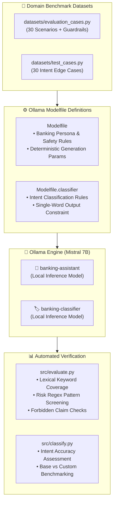

<div align="center">

# 🏦 FinOllama: Banking LLM Studio

### *Domain-Adapted, Safety-Hardened Banking AI Running 100% Locally via Ollama*

<br/>

[](https://python.org)
[](https://ollama.com)
[](https://mistral.ai)
[](LICENSE)
[](https://ollama.com)

<p align="center">
  <b>Two Production-Grade Custom Models</b> • <b>Deterministic Safety Guardrails</b> • <b>Built-in Evaluation Suite</b>
</p>

[Quick Start](#-quick-start) • [Architecture](#-architecture) • [Custom Models](#-the-custom-models) • [Evaluation Suite](#-benchmarking--evaluation) • [Interactive Chat](#-interactive-chat)

---

</div>

<br/>

## 🌟 Overview

**FinOllama** transforms standard open-weights LLMs into high-precision, compliant banking models designed specifically for Indian customer service and intent classification.

Built natively on **Ollama’s Modelfile architecture**, it eliminates cloud API dependencies, eliminates recurring token costs, and ensures zero sensitive financial data ever leaves your local machine.

<br/>

<table>
  <tr>
    <td width="50%" valign="top">
      <h3>🛡️ 1. Banking Assistant</h3>
      <p>A domain-specialized customer advisor engineered to resolve queries on <b>overdue payments, duplicate deductions, loan foreclosures, chargebacks, and fraud reporting</b> with zero hallucinations.</p>
      <ul>
        <li>🔒 Strict guardrails against credential phishing (OTP/PIN/CVV)</li>
        <li>⚖️ Never fabricates issuer charges, fee waivers, or timelines</li>
        <li>🏢 Routes sensitive queries to authenticated banking portals</li>
      </ul>
    </td>
    <td width="50%" valign="top">
      <h3>⚡ 2. Intent Classifier</h3>
      <p>A deterministic classification engine built to route incoming customer messages into 4 core banking verticals with instant sub-millisecond inference.</p>
      <ul>
        <li>🎯 Categories: <code>Payment</code>, <code>Refund</code>, <code>Loan</code>, <code>Credit Card</code></li>
        <li>🧠 Disambiguates complex overlaps (e.g., card payment vs card issue)</li>
        <li>⚡ Token-constrained single-word output for pipeline integration</li>
      </ul>
    </td>
  </tr>
</table>

<br/>

## 💎 Why FinOllama?

<div align="center">

| Feature | Standard Base LLM | 🏦 FinOllama Custom Model |
| :--- | :---: | :---: |
| **Credential Safety** | ⚠️ May prompt user for sensitive info | 🛡️ **Absolute refusal of OTP, PIN, CVV, Card numbers** |
| **Policy Hallucinations** | ⚠️ Promises resolution dates (e.g. "Refund tomorrow") | ✅ **Refuses unverified guarantees; clarifies policies** |
| **Response Determinism** | 🎲 Random temperature drift | 🎯 **Zero-temperature calibrated outputs** |
| **Privacy & Security** | ☁️ Third-party cloud calls | 💻 **100% Local (Runs on 4GB+ GPU / CPU)** |
| **Intent Categorization** | 📝 Verbose conversational clutter | ⚡ **Strict single-word category tags** |

</div>

<br/>

## 🏗️ Architecture



<br/>

## 📁 Repository Structure

```
FinOllama/
├── 📄 Modelfile                  # Ollama definition for banking-assistant
├── 📄 Modelfile.classifier       # Ollama definition for banking-classifier
├── 📄 requirements.txt           # Python environment dependencies
│
├── 📂 datasets/                  # Domain-specific banking benchmarks
│   ├── evaluation_cases.py       # 30 real-world customer service scenarios
│   └── test_cases.py             # 30 intent classification test cases
│
├── 📂 src/                       # Application code
│   ├── create_models.py          # One-command Ollama build & registration
│   ├── evaluate.py               # Comprehensive evaluation & comparison engine
│   ├── classify.py               # Intent classifier benchmark harness
│   └── main.py                   # Interactive terminal chat client
│
└── 📂 results/                   # Benchmark CSV reports & comparison logs
```

<br/>

## 🚀 Quick Start

### 1. Prerequisites

Ensure you have [Python 3.10+](https://www.python.org/) and [Ollama](https://ollama.com/) installed and running on your system.

```bash
# Verify installations
python --version
ollama --version
```

### 2. Setup Environment

```bash
# Clone the repository
git clone https://github.com/your-username/FinOllama.git
cd FinOllama

# Create & activate a virtual environment
python -m venv .venv

# Windows (PowerShell)
.\.venv\Scripts\Activate.ps1

# Linux / macOS
source .venv/bin/activate

# Install requirements
pip install -r requirements.txt

# Pull the base model
ollama pull mistral
```

<details>
<summary>💡 <b>PowerShell script execution policy note (Windows)</b></summary>

If PowerShell blocks script activation, run:
```powershell
Set-ExecutionPolicy -Scope Process -ExecutionPolicy Bypass
.\.venv\Scripts\Activate.ps1
```
</details>

<br/>

### 3. Build Custom Models

Run the automated build script to register both models with Ollama:

```bash
python src/create_models.py
```

<div align="center">
<pre>
============================================================
CREATING CUSTOM OLLAMA MODELS
============================================================
Creating model: banking-assistant
Modelfile: .../Modelfile
SUCCESS: Model 'banking-assistant' created

Creating model: banking-classifier
Modelfile: .../Modelfile.classifier
SUCCESS: Model 'banking-classifier' created

============================================================
SUMMARY
============================================================
  banking-assistant         [CREATED] - Banking customer support assistant
  banking-classifier        [CREATED] - Banking intent classifier
</pre>
</div>

Verify that the models are registered:
```bash
ollama list
```

---

<br/>

## 💻 The Custom Models

### 🤖 `banking-assistant`

Specialized in providing direct, safe banking advice. Built with safety boundaries that prevent hallucinated fees or false promises.

```dockerfile
FROM mistral:latest

SYSTEM """You are a professional banking customer support assistant for customers in India.
- Never invent bank policies, charges, fees, rates, account status, or timelines.
- Never guarantee refunds, reversals, approvals or investigation outcomes.
- Never ask for or encourage disclosure of OTP, CVV, PIN, password or full card number.
- Direct customers to authenticated official bank channels."""

PARAMETER temperature 0
PARAMETER top_p 0.9
PARAMETER top_k 40
PARAMETER num_predict 700
```

### 🏷️ `banking-classifier`

Engineered for instant, deterministic message categorization with maximum token economy.

```dockerfile
FROM mistral:latest

SYSTEM """You are a banking intent classification engine.
Classify messages into: Payment, Refund, Loan, Credit Card.
Priority Rule: If a credit card is mentioned but the problem concerns paying a bill, classify as Payment.
Return ONLY the category name."""

PARAMETER temperature 0
PARAMETER num_predict 10
```

---

<br/>

## 📊 Benchmarking & Evaluation

FinOllama comes with built-in test suites to measure compliance, point coverage, and classification accuracy.

### 1. Banking Assistant Evaluation

Evaluate `banking-assistant` across 30 complex scenarios:

```bash
# Evaluate custom model
python src/evaluate.py

# Compare Base Mistral vs Custom Banking Assistant head-to-head
python src/evaluate.py --compare
```

#### What it measures:
* **Point Coverage (%):** Percentage of mandatory guidance steps successfully delivered to the customer.
* **Risk Flags:** Real-time regex detection of prohibited advice (e.g., credential requests, false guarantees).
* **Forbidden Claims:** Verification that explicitly prohibited assertions never occur.

*Sample output from `--compare`:*
```
======================================================================
COMPARISON RESULTS
======================================================================
Metric                         Base (mistral)          Custom      Delta
----------------------------------------------------------------------
Avg Coverage                           68.42%          89.15%    +20.73%
Total Risk Flags                            6               0         -6
Forbidden Claims Found                      2               0         -2
Successful Evaluations                     30              30
======================================================================
```

<br/>

### 2. Intent Classifier Benchmark

Benchmark classification precision against 30 multi-intent customer prompts:

```bash
# Evaluate intent classifier
python src/classify.py

# Side-by-side comparison with the base model
python src/classify.py --compare
```

*Sample comparison result:*
```
============================================================
CLASSIFIER COMPARISON
============================================================
Model                       Accuracy    Correct    Total
------------------------------------------------------------
mistral:latest                76.67%         23       30
banking-classifier            96.67%         29       30
------------------------------------------------------------
Improvement                  +20.00%
============================================================
```

All evaluation runs export structured data directly to `results/*.csv` for auditing.

---

<br/>

## 💬 Interactive Chat

### Via Python Client

Experience the model directly in an interactive terminal session:

```bash
python src/main.py
```

```
Banking Assistant (banking-assistant)
Type your question or 'quit' to exit.

You: I noticed an unauthorized charge on my credit card. What should I do?

Assistant:
1. Immediately block or freeze your credit card using your bank's official mobile 
   app or authenticated net banking portal to prevent further unauthorized charges.
2. Report the unauthorized transaction to your bank's official dispute channel 
   as soon as possible.
3. Note the date, time, and amount of the transaction for reference.
4. Never share your OTP, PIN, CVV, or card credentials with anyone.
```

### Via Direct Ollama CLI

You can also run both models natively using the Ollama CLI:

```bash
# Chat with the assistant
ollama run banking-assistant

# Test the classifier
ollama run banking-classifier "Can I prepay my personal loan early?"
# Output: Loan
```

---

<br/>

## ⚙️ Customization & Fine-Tuning

### Adapting Prompts & Policies
To tailor the models to a specific financial institution or regional guidelines:
1. Open [`Modelfile`](file:///c:/Users/Rishav/Disk/Codes/LLM%20Projects/Fine_Tuning/Modelfile) or [`Modelfile.classifier`](file:///c:/Users/Rishav/Disk/Codes/LLM%20Projects/Fine_Tuning/Modelfile.classifier).
2. Update the `SYSTEM` instructions or `PARAMETER` directives.
3. Re-run `python src/create_models.py`.

### Upgrading the Base Architecture
Want to swap Mistral for Llama 3, Gemma, or Qwen? Just update the `FROM` line:
```dockerfile
FROM llama3.1:8b
# or
FROM qwen2.5:7b
```

---

<br/>

## 💻 Hardware Requirements

| Component | Minimum Specification | Recommended |
| :--- | :--- | :--- |
| **OS** | Windows 10/11, macOS, or Linux | Any modern 64-bit OS |
| **RAM** | 8 GB System Memory | 16 GB System Memory |
| **GPU** | Optional (runs on CPU) | NVIDIA GPU (4 GB+ VRAM, e.g., RTX 3050) |
| **Storage** | 6 GB free disk space | SSD for fast weight loading |

---

<br/>

## 📜 License

This project is licensed under the **MIT License** — feel free to use, modify, and distribute it for both commercial and personal applications.

<br/>

<div align="center">
  <sub>Engineered with precision for private, safe, and reliable financial intelligence.</sub>
</div>
