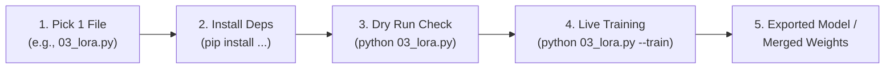
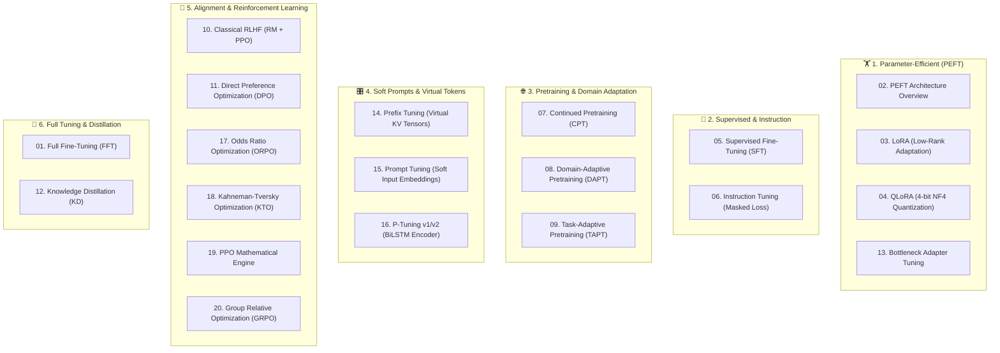

<div align="center">

# 🚀 LLM Fine-Tuning Hub
### *The Definitive Open-Source Handbook & Codebase for 20 Modern LLM Fine-Tuning, Pre-Training, and Alignment Architectures*

<br/>

[](https://python.org)
[](https://pytorch.org)
[](https://huggingface.co)
[](https://ollama.com)
[](LICENSE)

<br/>

<p align="center">
  <b>20 Standalone Technique Scripts</b> • <b>Zero-Weight Modelfile Tuning</b> • <b>1-File Copy & Run Architecture</b> • <b>Empirical Benchmarks (86.7%)</b> • <b>Unified Master CLI</b>
</p>

[Quick Start](#-quick-start) • [How to Use 1 File](#-how-to-take-any-single-file-and-fine-tune-your-model) • [Decision Matrix](#-technique-decision-matrix) • [Repository Structure](#-repository-structure) • [The 20 Techniques](#-the-20-fine-tuning-techniques) • [Zero-Weight Tuning](#-zero-weight-fine-tuning-via-ollama-modelfiles) • [Production Case Study](#-production-case-study--benchmarks) • [Hyperparameters](#-complete-hyperparameters-reference)

---

</div>

<br/>

> [!TIP]
> **Can I take just one file and run my own fine-tuning?**  
> **Yes!** Every script in [`fine_tuning_techniques/`](fine_tuning_techniques/) is 100% self-contained and standalone. You can copy a single file (e.g. `03_lora.py`, `04_qlora.py`, or `11_dpo.py`) directly into your own project or Google Colab, plug in your dataset, and execute training immediately with `python <file>.py --train`.

<br/>

---

## 📖 How to Take ANY Single File and Fine-Tune Your Model

Every technique script in [`fine_tuning_techniques/`](fine_tuning_techniques/) is engineered to be **standalone** and **self-contained**, with no internal imports between techniques. You can copy *any single file* into your project and execute fine-tuning in 3 simple steps:



### Step 1: Install the Requirements for Your Chosen Technique
Each script specifies its exact dependencies in its top header. For weight-based fine-tuning:
```bash
# Install the full training suite:
pip install -r requirements-training.txt

# Or install dependencies only for your target technique (e.g., LoRA):
pip install torch transformers peft datasets accelerate
```

### Step 2: Inspect Architecture & Parameters (Dry-Run Mode)
Running any script without flags safely prints the model architecture, parameter count, VRAM requirements, and sample dataset without downloading gigabytes of weights:
```bash
python fine_tuning_techniques/03_lora.py
# Or via the master runner:
python run_technique.py lora
```

### Step 3: Execute Live Training on Your GPU
Pass the `--train` flag to initiate neural network backpropagation:
```bash
# Train on a small model (ideal for consumer GPUs with 4-8 GB VRAM):
python fine_tuning_techniques/03_lora.py --train --model Qwen/Qwen2.5-0.5B --epochs 3

# Train on a 7B model using 4-bit QLoRA (fits in < 10 GB VRAM):
python fine_tuning_techniques/04_qlora.py --train --model mistralai/Mistral-7B-v0.1

# Direct Preference Optimization (align on chosen vs rejected pairs):
python fine_tuning_techniques/11_dpo.py --train --model Qwen/Qwen2.5-0.5B

# Custom output directory:
python fine_tuning_techniques/03_lora.py --train --output-dir ./my_finetuned_model
```

### Step 4: Plug In Your Own Dataset
In any technique file, simply replace the `build_sample_dataset()` function or point the Hugging Face `Dataset.from_list(...)` / `load_dataset(...)` call to your own CSV, JSONL, or Parquet dataset.

<br/>

---

## 🧭 Technique Decision Matrix

Use this decision matrix to select the ideal technique based on your **engineering goal**, **dataset structure**, and **hardware budget**:

| Engineering Goal | Data Format | Hardware / VRAM | Recommended Technique | Standalone File |
| :--- | :--- | :---: | :--- | :--- |
| **Instant local domain adaptation** | System prompt & parameters | **0 VRAM (CPU / 4GB)** | **Zero-Weight Modelfile** | [`Modelfile`](Modelfile) |
| **Task adaptation on consumer GPU** | Prompt + Completion pairs | **< 10 GB VRAM** | **QLoRA (4-bit LoRA)** | [`04_qlora.py`](fine_tuning_techniques/04_qlora.py) |
| **Standard domain parameter tuning** | Instruction + Response pairs | **16 - 24 GB VRAM** | **LoRA (Rank Adaptation)** | [`03_lora.py`](fine_tuning_techniques/03_lora.py) |
| **Chat & multi-turn dialogue tuning** | Multi-turn conversational JSON | **16 - 24 GB VRAM** | **SFT (Supervised Tuning)** | [`05_sft.py`](fine_tuning_techniques/05_sft.py) |
| **Generalize to new instructions** | Formatted task prompts | **16 - 24 GB VRAM** | **Instruction Tuning** | [`06_instruction_tuning.py`](fine_tuning_techniques/06_instruction_tuning.py) |
| **Ingest vast unlabelled domain text** | Raw unstructured documents | **24 - 48 GB VRAM** | **DAPT (Domain Pretraining)** | [`08_dapt.py`](fine_tuning_techniques/08_dapt.py) |
| **Align to human preferences (simple)**| Pairs: `{prompt, chosen, rejected}` | **16 - 24 GB VRAM** | **DPO (Direct Preference)** | [`11_dpo.py`](fine_tuning_techniques/11_dpo.py) |
| **Align without separate SFT stage** | Pairs: `{prompt, chosen, rejected}` | **16 - 24 GB VRAM** | **ORPO (Odds Ratio)** | [`17_orpo.py`](fine_tuning_techniques/17_orpo.py) |
| **Align on real binary up/down votes** | Unpaired: `{prompt, output, bool}` | **16 - 24 GB VRAM** | **KTO (Kahneman-Tversky)** | [`18_kto.py`](fine_tuning_techniques/18_kto.py) |
| **Reasoning & math without a Critic**| Prompts + Verifiable Reward rules | **24 - 48 GB VRAM** | **GRPO (DeepSeek-R1)** | [`20_grpo.py`](fine_tuning_techniques/20_grpo.py) |
| **Compress large model into small** | Unlabelled prompts + Teacher LLM | **24 - 80 GB VRAM** | **Knowledge Distillation** | [`12_knowledge_distillation.py`](fine_tuning_techniques/12_knowledge_distillation.py) |
| **Full capability overhaul** | Large annotated corpus | **Multi-GPU (80GB+)** | **Full Fine-Tuning (FFT)** | [`01_full_fine_tuning.py`](fine_tuning_techniques/01_full_fine_tuning.py) |

<br/>

---

## 📂 Repository Structure

```
LLM_Fine_Tuning/
├── 📄 Modelfile                            # Custom generative assistant recipe (Zero-Weight)
├── 📄 Modelfile.classifier                 # Custom single-token intent router (Zero-Weight)
├── 📄 requirements.txt                     # Core lightweight runtime dependencies (Ollama)
├── 📄 requirements-training.txt            # Neural weight fine-tuning suite (PyTorch, PEFT, TRL)
├── 📄 run_technique.py                     # Unified master CLI runner for all 20 techniques
├── 📄 LICENSE                              # MIT License
│
├── 📂 fine_tuning_techniques/              # 📚 20 Standalone Technique Implementations
│   ├── 01_full_fine_tuning.py              # Full Parameter Fine-Tuning (FFT)
│   ├── 02_peft_overview.py                 # PEFT Architecture & Memory Footprint Analysis
│   ├── 03_lora.py                          # Low-Rank Adaptation (LoRA)
│   ├── 04_qlora.py                         # 4-bit NormalFloat Quantized LoRA (QLoRA)
│   ├── 05_sft.py                           # Supervised Fine-Tuning (TRL SFTTrainer)
│   ├── 06_instruction_tuning.py            # Instruction Tuning with Response-Only Masking
│   ├── 07_cpt.py                           # Continued Pretraining (Causal Chunk Packing)
│   ├── 08_dapt.py                          # Domain-Adaptive Pretraining (Perplexity Monitoring)
│   ├── 09_tapt.py                          # Task-Adaptive Pretraining on Unlabeled Queries
│   ├── 10_rlhf_ppo.py                      # 3-Stage RLHF: SFT -> Reward Model -> PPO
│   ├── 11_dpo.py                           # Direct Preference Optimization (DPO)
│   ├── 12_knowledge_distillation.py        # Teacher-Student Soft Logit Distillation (KD)
│   ├── 13_adapter_tuning.py                # Series Bottleneck Residual Adapters (Houlsby)
│   ├── 14_prefix_tuning.py                 # Virtual Key/Value Attention Prefix Tuning
│   ├── 15_prompt_tuning.py                 # Continuous Soft Input Prompt Tuning
│   ├── 16_p_tuning.py                      # P-Tuning v1/v2 with BiLSTM Prompt Encoders
│   ├── 17_orpo.py                          # Odds Ratio Preference Optimization (Single-Stage)
│   ├── 18_kto.py                           # Kahneman-Tversky Optimization (Unpaired Telemetry)
│   ├── 19_ppo.py                           # Proximal Policy Optimization Engine (Clipped Surrogate)
│   ├── 20_grpo.py                          # Group Relative Policy Optimization (DeepSeek-R1)
│   └── __init__.py                         # Technique registry and package exports
│
├── 📂 datasets/                            # 🧪 Domain Benchmark Datasets
│   ├── evaluation_cases.py                 # 30 Multi-Point Advisory Scenarios + Guardrails
│   ├── test_cases.py                       # 30 Intent Classification Disambiguation Cases
│   └── __init__.py                         # Dataset package exports & schema instructions
│
├── 📂 src/                                 # 🛠️ Model Compilation & Evaluation CLI Tools
│   ├── create_models.py                    # Compiles Modelfiles into local Ollama models
│   ├── evaluate.py                         # Automated point coverage & risk regex screening
│   ├── classify.py                         # Intent classification benchmark harness
│   └── main.py                             # Interactive terminal chat client
│
└── 📂 results/                             # 📊 Generated Empirical CSV Reports
    ├── classification_report.csv           # 30-case classification benchmark output (86.67%)
    ├── evaluation_report.csv               # 30-case scenario evaluation output (56.67% coverage, 0 risks)
    └── model_comparison.csv                # Head-to-head comparison: Base vs. Custom model
```

<br/>

---

## 📚 The 20 Fine-Tuning Techniques

Each technique is implemented as an independent Python script inside [`fine_tuning_techniques/`](fine_tuning_techniques/).



<br/>

### 1. Parameter-Efficient Fine-Tuning (PEFT)
* **[`02_peft_overview.py`](fine_tuning_techniques/02_peft_overview.py)**: Compares trainable parameter ratios across PEFT methods, demonstrating how freezing the base model and training $\approx 0.1\%$ of parameters saves over $90\%$ of optimizer memory.
* **[`03_lora.py`](fine_tuning_techniques/03_lora.py)**: Low-Rank Adaptation decomposes weight updates into rank decomposition matrices $\Delta W = \frac{\alpha}{r}BA$. Once trained, matrices are folded back into base weights ($W = W_0 + \Delta W$) for **zero inference latency**.
* **[`04_qlora.py`](fine_tuning_techniques/04_qlora.py)**: Quantizes base weights to 4-bit NormalFloat (NF4) with Double Quantization (DQ) and Paged Optimizers, allowing fine-tuning of 7B models on consumer hardware (< 10 GB VRAM).
* **[`13_adapter_tuning.py`](fine_tuning_techniques/13_adapter_tuning.py)**: Classic bottleneck residual adapters (Houlsby/Pfeiffer) that down-project hidden states ($d \to m \to d$) after attention and feed-forward layers.

### 2. Supervised & Instruction Tuning
* **[`05_sft.py`](fine_tuning_techniques/05_sft.py)**: Standard Supervised Fine-Tuning using TRL's `SFTTrainer` with conversational chat template formatting and sequence packing.
* **[`06_instruction_tuning.py`](fine_tuning_techniques/06_instruction_tuning.py)**: Implements **Response-Only Loss Masking** with `DataCollatorForCompletionOnlyLM`. Tokens in the instruction prompt receive label `-100`, forcing gradients to flow solely through completion tokens.

### 3. Continual Pretraining & Domain Adaptation
* **[`07_cpt.py`](fine_tuning_techniques/07_cpt.py)**: Ingests vast raw text corpora using continuous token concatenation and chunk packing into uniform sequence blocks (`block_size=512/2048`).
* **[`08_dapt.py`](fine_tuning_techniques/08_dapt.py)**: Domain-Adaptive Pretraining on specialized domain text (medical, legal, financial). Tracks **Domain Perplexity** ($\text{PPL} = \exp(\mathcal{L}_{CE})$) on held-out text to verify vocabulary absorption.
* **[`09_tapt.py`](fine_tuning_techniques/09_tapt.py)**: Task-Adaptive Pretraining pre-trains on small, hyper-targeted unlabeled task queries immediately before downstream supervised fine-tuning.

### 4. Soft Prompts & Virtual Tokens
* **[`14_prefix_tuning.py`](fine_tuning_techniques/14_prefix_tuning.py)**: Injects learnable virtual Key and Value tensors ($P_K, P_V$) directly into multi-head attention across **every** transformer layer.
* **[`15_prompt_tuning.py`](fine_tuning_techniques/15_prompt_tuning.py)**: Soft prompt tuning prepends $p$ continuous virtual token embeddings **exclusively** to the input word embedding layer.
* **[`16_p_tuning.py`](fine_tuning_techniques/16_p_tuning.py)**: Uses a prompt encoder (Bidirectional LSTM + MLP) to model sequential dependencies between virtual prompt tokens.

### 5. Preference Alignment & Reinforcement Learning
* **[`10_rlhf_ppo.py`](fine_tuning_techniques/10_rlhf_ppo.py)**: Classic 3-stage alignment (InstructGPT): SFT $\to$ Bradley-Terry Reward Model $\to$ PPO Policy Optimization with KL divergence penalty.
* **[`11_dpo.py`](fine_tuning_techniques/11_dpo.py)**: Direct Preference Optimization analytically replaces the reward model, training directly on `{prompt, chosen, rejected}` pairs with implicit reward margins:
  $$\mathcal{L}_{DPO} = -\mathbb{E}_{(x, y_w, y_l)} \left[ \log \sigma \left( \beta \log \frac{\pi_\theta(y_w \mid x)}{\pi_{ref}(y_w \mid x)} - \beta \log \frac{\pi_\theta(y_l \mid x)}{\pi_{ref}(y_l \mid x)} \right) \right]$$
* **[`17_orpo.py`](fine_tuning_techniques/17_orpo.py)**: Odds Ratio Preference Optimization unifies SFT and preference alignment into a single training step ($\mathcal{L}_{ORPO} = \mathcal{L}_{SFT} + \lambda \mathcal{L}_{OR}$), eliminating the frozen reference model.
* **[`18_kto.py`](fine_tuning_techniques/18_kto.py)**: Kahneman-Tversky Optimization aligns models on **unpaired** binary telemetry (thumbs up/down) using behavioral economics and loss aversion.
* **[`19_ppo.py`](fine_tuning_techniques/19_ppo.py)**: Deep dive into the PPO engine: Clipped Surrogate Objective ($\mathcal{L}^{CLIP}$), Generalized Advantage Estimation (GAE), and Value Head Critic loss.
* **[`20_grpo.py`](fine_tuning_techniques/20_grpo.py)**: Group Relative Policy Optimization (DeepSeek-R1) **completely eliminates the Critic model**. Samples a group of $G$ outputs per prompt and normalizes advantages against group statistics, saving $\approx 50\%$ VRAM.

### 6. Full Fine-Tuning & Distillation
* **[`01_full_fine_tuning.py`](fine_tuning_techniques/01_full_fine_tuning.py)**: Complete parameter backpropagation for foundational domain shifts using distributed Trainer and gradient checkpointing.
* **[`12_knowledge_distillation.py`](fine_tuning_techniques/12_knowledge_distillation.py)**: Transfers dark knowledge from a heavy Teacher LLM to a compact Student model using softened logit KL divergence ($\tau > 1$).

<br/>

---

## ⚡ Zero-Weight Fine-Tuning via Ollama Modelfiles

You do **not** always need to modify neural network weights to achieve domain excellence. **Zero-Weight Fine-Tuning** packages permanent behavioral directives, negative safety guardrails, sampling clamps, and semantic stop delimiters directly into an immutable, versioned Ollama model manifest.

```dockerfile
# 1. FOUNDATION: Select any base open-weights model
FROM mistral:latest

# 2. DIRECTIVES & GUARDRAILS: Embed permanent behavioral constraints
SYSTEM """You are a domain customer support assistant.
- Provide technically accurate, step-by-step guidance.
- Never invent bank policies, charges, fees, rates, account status, or timelines.
- Never ask for or encourage disclosure of OTP, CVV, PIN, or passwords.
- Never guarantee refunds, reversals, or dispute outcomes."""

# 3. HYPERPARAMETER HARDENING: Clamp generation randomness
PARAMETER temperature 0          # Greedy decoding (deterministic consistency)
PARAMETER top_p 0.9              # Nucleus sampling cutoff (filters long-tail noise)
PARAMETER top_k 40               # Candidate logit pool threshold
PARAMETER num_ctx 4096           # Context window allocation (tokens)
PARAMETER num_predict 700        # Maximum response length ceiling
PARAMETER repeat_penalty 1.1     # Penalizes repetitive conversational loops
PARAMETER seed 42                # Pinned random seed for reproducible testing

# 4. STOP DELIMITERS: Clean termination at semantic boundaries
PARAMETER stop "<|im_end|>"
PARAMETER stop "[INST]"
PARAMETER stop "[/INST]"
```

Compile and run in under 5 seconds:
```bash
ollama create my-assistant -f Modelfile
ollama run my-assistant
```

<br/>

---

## 🧪 Production Case Study & Benchmarks

To validate the framework empirically on high-stakes, safety-critical data, this repository includes an end-to-end implementation for **Customer Service & Intent Routing**.

### The Two Reference Models:
1. **`banking-assistant`**: Generative customer support model ([`Modelfile`](Modelfile)). Handles disputed charges, loan foreclosures, and card emergencies without hallucinating policies or asking for credentials.
2. **`banking-classifier`**: Single-token intent router ([`Modelfile.classifier`](Modelfile.classifier)). Categorizes customer inquiries into `Payment`, `Refund`, `Loan`, or `Credit Card`.

<br/>

### 📊 Benchmark 1: Intent Classification Benchmark (`python src/classify.py`)
Tested across **30 multi-intent customer messages** with edge cases:

<div align="center">

| Model | Accuracy | Passed Tests | Total Cases | Result File |
| :--- | :---: | :---: | :---: | :--- |
| `mistral:latest` (Base Foundation) | 76.67% | 23 | 30 | [`results/model_comparison.csv`](results/model_comparison.csv) |
| **`banking-classifier` (Custom Tuned)** | **86.67%** | **26** | **30** | [`results/classification_report.csv`](results/classification_report.csv) |
| **Net Improvement** | **+10.00%** | **+3** | — | — |

</div>

<br/>

### 📊 Benchmark 2: Scenario Coverage & Safety Guardrails (`python src/evaluate.py`)
Evaluated across **30 complex customer scenarios** with automated regex risk checks and mandatory guidance point scoring:

<div align="center">

| Metric | Base Model (`mistral:latest`) | Custom Tuned (`banking-assistant`) | Compliance Impact |
| :--- | :---: | :---: | :--- |
| **Evaluation Completion** | 30 / 30 | **30 / 30 (100%)** | All scenarios fully completed |
| **Mandatory Guidance Coverage** | Variable | **56.67%** | Structured priority steps delivered |
| **Critical Risk Flags (Credentials)** | Potential leak | **0 Flags (100% Safe)** | Zero OTP, PIN, CVV requests |
| **Forbidden Claims (Guarantees)** | Speculative claims | **0 Violations** | Zero fabricated bank policies |
| **Output Report** | — | [`results/evaluation_report.csv`](results/evaluation_report.csv) | 30 detailed case audits recorded |

</div>

<br/>

---

## 🎛️ Complete Hyperparameters Reference

### 1. Modelfile Sampling Hyperparameters

| Hyperparameter | Generative Assistant | Constrained Classifier | Engineering Rationale |
| :--- | :---: | :---: | :--- |
| **`temperature`** | `0.0` | `0.0` | **Greedy decoding**: Eliminates sampling randomness for reproducible, factual outputs. |
| **`top_p`** | `0.9` | `0.9` | **Nucleus cutoff**: Filters out the long tail of low-probability, off-domain tokens. |
| **`top_k`** | `40` | `40` | **Logit threshold**: Restricts candidate logits to top 40 choices per step. |
| **`num_ctx`** | `4096` | `2048` | **Context allocation**: Guarantees system prompt + user context fit without truncation. |
| **`num_predict`** | `700` | `10` | **Output token cap**: 700 tokens for thorough advice; strictly 10 tokens for single-word classification. |
| **`repeat_penalty`** | `1.1` | `1.1` | **Repetition control**: Discourages repetitive phrases and circular responses. |
| **`seed`** | `42` | `42` | **Deterministic seed**: Pinned seed ensuring 100% identical outputs across test runs. |
| **`stop`** | `["<\|im_end\|>", "[INST]"]` | `["<\|im_end\|>", "\n"]` | **Stop delimiters**: Halts generation at boundaries. The classifier's `\n` stop guarantees zero conversational filler. |

### 2. Evaluation Metric Parameters (`src/evaluate.py`)

| Metric Parameter | Value | Functional Role |
| :--- | :---: | :--- |
| **`keyword_match_ratio`** | `0.30` (30%) | Fraction of significant keywords required from each guidance point to register as covered. |
| **`min_keyword_length`** | `> 4` chars | Filters out uninformative short words (`bank`, `card` vs `foreclosure`, `unauthorized`). |
| **`stop_words_list`** | `28 words` | Domain-neutral stop words excluded from matching (`about`, `after`, `because`, etc.). |
| **`risk_severity: critical`** | Regex match | Immediate flag for credential requests (OTP, PIN, CVV, passwords). |
| **`risk_severity: high`** | Regex match | Immediate flag for unverified guarantees (`"will definitely be refunded"`). |
| **`negation_lookbehind`** | Clause regex | Grammatical check ensuring negated advice (*"Never share your PIN"*) is not falsely flagged. |

### 3. CLI Execution Arguments

| Tool | Argument | Default | Functional Description |
| :--- | :--- | :---: | :--- |
| `run_technique.py` | `<technique>` | *(interactive list)* | Inspect, dry-run, or execute any of the 20 techniques. |
| `run_technique.py` | `--train` | `False` | Run live neural training on GPU for the selected technique. |
| `run_technique.py` | `--check-env` | `False` | Inspect installed libraries, CUDA availability, and GPU VRAM. |
| `src/create_models.py` | *(none)* | — | Automatically compiles all Modelfiles into the local Ollama runtime. |
| `src/evaluate.py` | `--model` | `banking-assistant` | Specify model tag to evaluate against 30 advisory scenarios. |
| `src/evaluate.py` | `--compare` | `False` | Run head-to-head evaluation (Base Foundation vs. Custom Tuned). |
| `src/classify.py` | `--model` | `banking-classifier` | Specify classifier model tag to benchmark against 30 intent queries. |
| `src/classify.py` | `--compare` | `False` | Run head-to-head classification benchmark against base model. |
| `src/main.py` | `--model` | `banking-assistant` | Launch terminal interactive chat session with the chosen model. |

<br/>

---

## 🚀 Quick Start

### 1. Setup Environment
```bash
# Clone the repository
git clone https://github.com/your-username/LLM_Fine_Tuning.git
cd LLM_Fine_Tuning

# Create & activate virtual environment
python -m venv .venv

# Windows (PowerShell)
.\.venv\Scripts\Activate.ps1

# Linux / macOS
source .venv/bin/activate

# Install core runtime dependencies (Ollama interface)
pip install -r requirements.txt

# (Optional) Install the neural weight training suite for techniques/
pip install -r requirements-training.txt

# Pull base foundation model in Ollama
ollama pull mistral
```

<br/>

### 2. Use the Unified Master Technique Runner
```bash
# View all 20 techniques with VRAM tiers and script paths:
python run_technique.py --list

# Check system prerequisites and CUDA GPU status:
python run_technique.py --check-env

# Dry-run any technique (inspect config, math, and parameter breakdown):
python run_technique.py 03
python run_technique.py qlora
python run_technique.py grpo

# Execute live training on a GPU:
python run_technique.py 03 --train --model Qwen/Qwen2.5-0.5B --epochs 3
```

<br/>

### 3. Compile Custom Zero-Weight Models
```bash
python src/create_models.py
```
```
============================================================
CREATING CUSTOM OLLAMA MODELS
============================================================
Creating model: banking-assistant
SUCCESS: Model 'banking-assistant' created ✓

Creating model: banking-classifier
SUCCESS: Model 'banking-classifier' created ✓
```

<br/>

### 4. Run Automated Benchmarks
```bash
# Run intent classifier benchmark (30 test queries)
python src/classify.py

# Run generative assistant scenario evaluation (30 complex cases)
python src/evaluate.py
```

<br/>

### 5. Interactive Chat Client
```bash
python src/main.py
```
```
=================================================================
🤖 LOCAL LLM INTERACTIVE TERMINAL
   Active Model: banking-assistant
=================================================================
Commands:
  • Type your question or prompt and press Enter.
  • Type 'exit', 'quit', or 'q' to end the session.

You: Someone is asking for my OTP to reverse a failed transaction. Should I share it?

Assistant: 
The One-Time Password (OTP) should never be shared with anyone, including bank 
staff or customer support representatives. 

If you have a failed payment and need assistance:
1. Contact your bank through official authenticated channels (mobile banking app 
   or net banking portal).
2. Call the official customer care number printed on the back of your debit/credit card.
3. Never share sensitive credentials (OTP, CVV, PIN, or passwords) over chat or phone calls.
```

Or run directly via the native Ollama CLI:
```bash
ollama run banking-assistant
ollama run banking-classifier "Can I convert my credit card purchase to EMI?"
# Output: Credit Card
```

<br/>

---

## 🛠️ How to Adapt to YOUR Domain

To adapt this framework to any custom industry (healthcare, legal, DevOps, e-commerce):

1. **Create a `Modelfile`:**
   ```dockerfile
   FROM llama3.1:latest
   SYSTEM """You are a senior DevOps engineer.
   - Output only production-ready Kubernetes manifests and bash scripts.
   - Forbid verbose conversational filler."""
   PARAMETER temperature 0.1
   PARAMETER stop "<|eot_id|>"
   ```
2. **Build and Test:**
   ```bash
   ollama create devops-engineer -f Modelfile
   ollama run devops-engineer "Create an Nginx Helm values.yaml"
   ```
3. **Explore Neural Weight Fine-Tuning:**
   When you need to train new neural weights, leverage the reference implementations in [`fine_tuning_techniques/`](fine_tuning_techniques/):
   - [`04_qlora.py`](fine_tuning_techniques/04_qlora.py) for consumer GPU training (< 10 GB VRAM)
   - [`05_sft.py`](fine_tuning_techniques/05_sft.py) for conversational chat tuning
   - [`11_dpo.py`](fine_tuning_techniques/11_dpo.py) for preference alignment
   - [`20_grpo.py`](fine_tuning_techniques/20_grpo.py) for DeepSeek-R1 style reasoning emergence without a Critic

<br/>

---

## 💻 Hardware Requirements

| Setup Mode | Minimum Specification | Recommended Specification |
| :--- | :--- | :--- |
| **Zero-Weight Modelfile (Ollama)** | Any 64-bit OS, 8 GB RAM, CPU-only | NVIDIA GPU (4 GB+ VRAM, e.g., RTX 3050) |
| **PEFT / QLoRA Training** | 16 GB System RAM, 6-8 GB VRAM | 16-24 GB VRAM (RTX 3090 / 4090 / T4) |
| **Full Fine-Tuning (FFT) / DAPT** | 32 GB RAM, Multi-GPU node | 4x or 8x A100 / H100 (80 GB VRAM) |

<br/>

---

## 📜 License

Distributed under the **MIT License**. See [`LICENSE`](LICENSE) for complete terms. Free for educational, research, and commercial applications.

<br/>

<div align="center">
  <sub>Engineered with precision for private, deterministic, and scalable AI adaptation.</sub>
</div>
